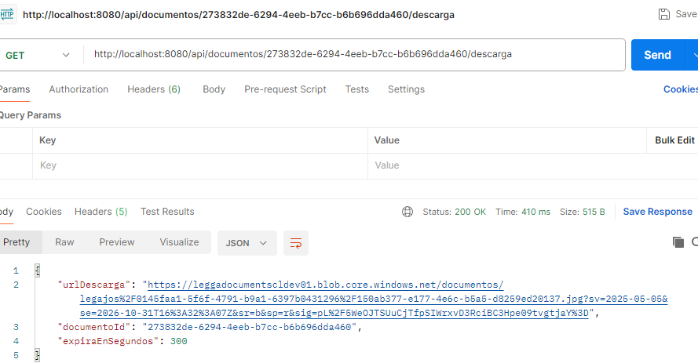
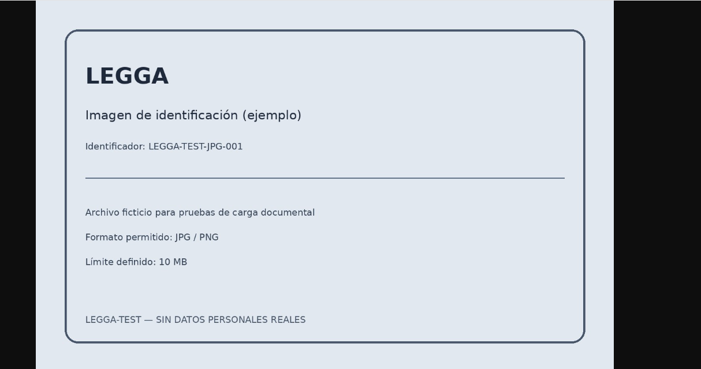
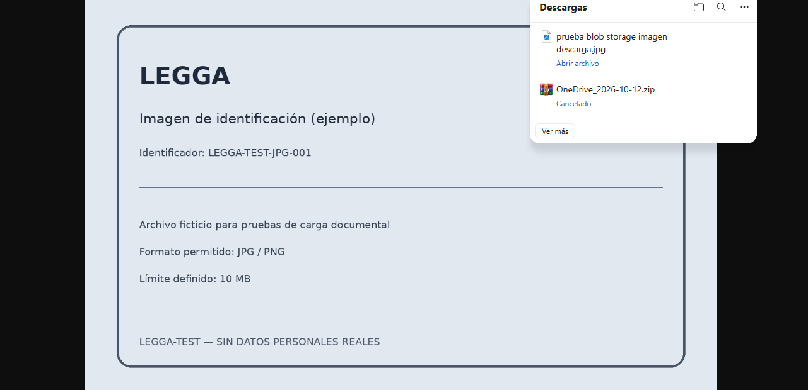

# Hito técnico: Descarga de documentos mediante SAS

## 1. Objetivo

Implementar un mecanismo seguro para que un usuario pueda descargar o visualizar un documento almacenado en Azure Blob Storage, sin exponer las credenciales de acceso al almacenamiento.

La funcionalidad utiliza una URL SAS (*Shared Access Signature*) temporal, con permiso de lectura y una vigencia de cinco minutos.

## 2. Contexto técnico

La funcionalidad forma parte del microservicio **MS-Documentos** de LEGGA.

| Componente | Responsabilidad |
|---|---|
| MS-Documentos | Recibe la solicitud de descarga y obtiene los metadatos del documento. |
| Base de datos | Mantiene los metadatos y la clave interna del archivo (`storageKey`). |
| Azure Blob Storage | Almacena el archivo físico. |
| URL SAS | Permite acceder temporalmente al archivo con permiso de lectura. |

## 3. Endpoint implementado

```http
GET /api/documentos/{id}/descarga
```

Ejemplo local:

```http
GET http://localhost:8080/api/documentos/{id}/descarga
```

El parámetro `id` corresponde al identificador del documento registrado en MS-Documentos.

### Respuesta esperada

Cuando el documento existe, el endpoint devuelve una respuesta `200 OK` con información de la descarga:

```json
{
  "documentoId": "UUID_DEL_DOCUMENTO",
  "urlDescarga": "URL_SAS_TEMPORAL",
  "expiraEnSegundos": 300
}
```

La URL SAS es temporal y no debe compartirse ni registrarse en documentación pública, ya que permite acceder al archivo durante su vigencia.

## 4. Flujo de descarga

1. El cliente solicita la descarga mediante el identificador del documento.
2. MS-Documentos consulta los metadatos del documento.
3. El microservicio obtiene la clave interna `storageKey`.
4. AzureBlobService genera una URL SAS con permiso de lectura.
5. La URL SAS tiene una vigencia de cinco minutos.
6. El cliente utiliza la URL para visualizar o descargar el archivo directamente desde Azure Blob Storage.

```text
Cliente
  |
  | GET /api/documentos/{id}/descarga
  v
MS-Documentos
  |
  | Busca metadatos por ID
  v
Base de datos
  |
  | Retorna storageKey
  v
AzureBlobService
  |
  | Genera SAS de lectura (5 minutos)
  v
Cliente
  |
  | Accede mediante URL SAS
  v
Azure Blob Storage
  |
  | Entrega el archivo
  v
Visualización o descarga
```

## 5. Seguridad

- La URL SAS se genera bajo demanda.
- El permiso otorgado es de lectura.
- La URL tiene una vigencia limitada de 300 segundos.
- La clave de almacenamiento no se entrega al cliente.
- La URL SAS debe tratarse como un dato sensible mientras esté vigente.
- La funcionalidad no requiere entregar la cadena de conexión de Azure al frontend.

## 6. Validación realizada

La funcionalidad fue probada utilizando Postman y un navegador web.

| Prueba | Resultado |
|---|---|
| Solicitud al endpoint de descarga | `200 OK` |
| Generación de URL SAS | Validada |
| Visualización de imagen desde Azure Blob Storage | Validada |
| Descarga y guardado del archivo en el equipo | Validada |
| Vigencia configurada | 300 segundos |

La prueba se realizó con un documento de imagen JPEG almacenado en Azure Blob Storage.

## 7. Evidencias

### 7.1 Respuesta del endpoint SAS


### 7.2 Visualización de la imagen en el navegador








### 7.3 Archivo descargado en el equipo


## 8. Estado del hito

**Implementado y validado localmente.**

La funcionalidad permite recuperar un documento mediante su identificador y generar un acceso temporal de lectura al archivo almacenado en Azure Blob Storage.
